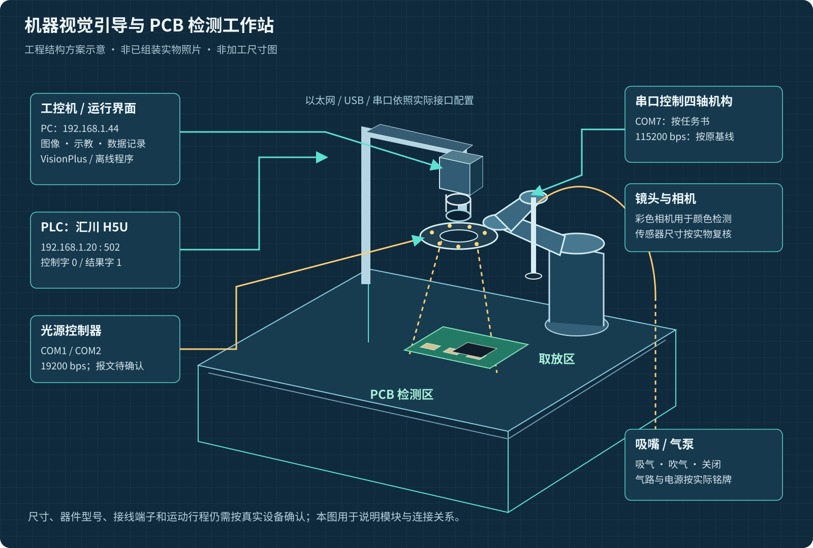
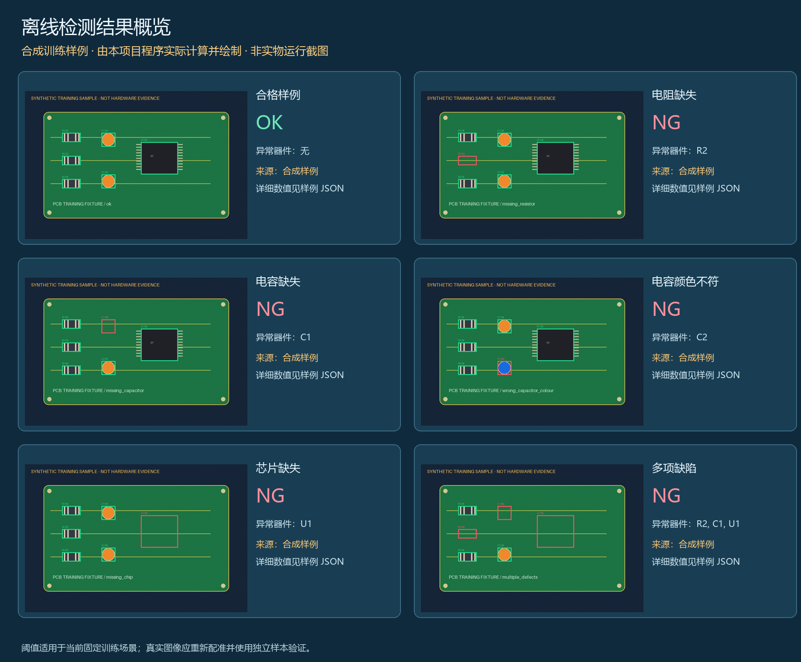

# 机器视觉工业运用

面向视觉引导抓取与 PCB 检测的培训项目，提供获准公开的 **VisionPlus 原始基线**、新增的 **Python 离线参考程序**、工程图解和可复现示例。



*根据培训任务书绘制的结构方案示意，非已组装实物照片、非加工尺寸图。外部器件照片、基线内原始图像、合成样例分别标明来源。*

原基线包含机械手示教、取放子流程和传统视觉工具；原 HMI 为空，仅配置了一个串口设备。新增程序可独立运行，完成固定 ROI 图像检测、九点平面映射、通信报文构造、图像与表格保存。**实物硬件、真实图像上的独立评估及 VisionPlus 全流程联调仍待完成。**

## 快速运行

需要 Python 3.10 或更高。离线程序只依赖 NumPy 和 Pillow，不依赖商业视觉平台。

```powershell
python -m pip install -r requirements.txt
python -m visionprep demo --output output/my-first-demo
```

打开生成的 `output/my-first-demo/index.html` 即可查看六个样例、器件结果、原图/标注图、CSV 和日志。输出目录非空时程序会拒绝覆盖。



*此概览根据程序实际生成的结果绘制，包含 1 个合格样例与 5 个缺陷样例。输入图像和标定点为合成训练数据，不代表现场检测准确率或实物运行截图。*

- [下载完整项目 v1.0.0](https://github.com/anl2992019662-max/machine-vision-national-prep/releases/tag/v1.0.0)
- [运行与配置](docs/usage.md)
- [图片、工程图与原始素材](docs/gallery.md)
- [培训要求与实现对应](docs/requirements.md)
- [通信、坐标与硬件接入](docs/commissioning.md)
- [验证记录与基线缺口](docs/validation.md)

## 提供哪些功能

| 内容 | 实现及验证范围 |
|---|---|
| 光学选型计算 | 按任务书公式计算焦距与双方向视野，避免只检查水平视野 |
| PCB 电阻检测 | 固定 ROI 灰度方差判断，提供电阻缺失样例 |
| 电容颜色与有无 | HSV 橙色/绿色比例，提供缺失、错误颜色样例 |
| 芯片有无 | 暗像素比例，提供缺失样例 |
| 二维视觉引导 | 配对点检查、平面仿射拟合、目标坐标转换、显式轴范围检查 |
| PLC 报文 | Modbus TCP 03/06 编解码、事务/长度/回显检查、可显式连接的客户端 |
| 机器人指令 | 按任务书生成回零、吸气、吹气、关闭、查询与坐标字符串 |
| 图像与数据保存 | 原图、标注图、逐项 JSON、CSV、用户日志和离线页面 |
| 原始基线 | 64 个获准公开的工程文件，保留平台标识与原字节哈希 |

当前 Python 检测使用已配准的固定位置示例。真实拍摄图需要重新定位、选择 ROI 和验证阈值；训练基线中的模板匹配工具保留供研究与接入。没有将原基线改写成已经联调完成的工业系统。

## 项目目录

```text
visionprep/              可执行的离线参考程序与通信编解码
examples/demo/           六类合成图、实际计算结果与可直接打开的页面
examples/hardware.example.json  任务书通信参数及待确认项
reference/visionplus/    获准公开的原始平台基线
docs/images/            7 张原创工程图、结果概览、原始素材与器件参考照片
docs/                   培训要求、接入、验证、使用与素材来源说明
tests/                  自动测试
tools/                  文件核对、基线查看副本和打包工具
manifests/              基线、图像与发布文件的哈希和来源清单
```

## 检查方式

```powershell
python -m pip install -r requirements-dev.txt
python -m unittest discover -s tests -v
python tools/verify.py
```

本地已通过 34 项自动测试，其中检测回归还覆盖三组随机噪声种子下的 18 个已知合成案例。软件测试、模拟坐标拟合、培训参考图和真实设备联调的证据范围见 [验证说明](docs/validation.md)。

## 许可与来源

新增 Python 程序、测试、工具、原创工程 SVG 与自生成样例采用 [MIT](LICENSE)。培训方基线、任务书内容、平台标识及外部照片按各自权利说明分开处理，见 [第三方与图片署名](THIRD_PARTY_NOTICES.md)。
