# 图片与工程图

本页区分原创结构方案、程序生成结果、原培训资料与外部设备参考照片。图片类型也写在图面或说明中。

## 工程结构与处理流程

### 工作站结构方案

### 系统连接与交互

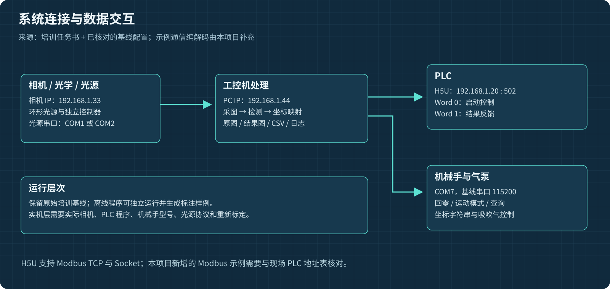

### PCB 检测流程

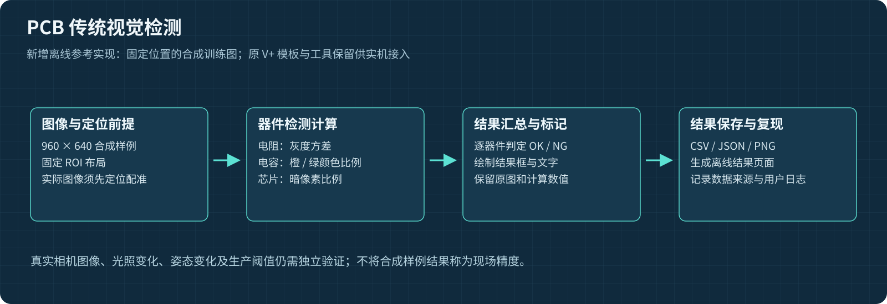

### 引导取放流程

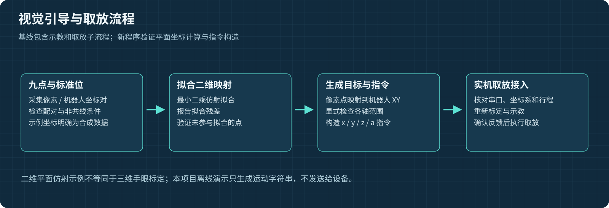

### 图像与数据记录

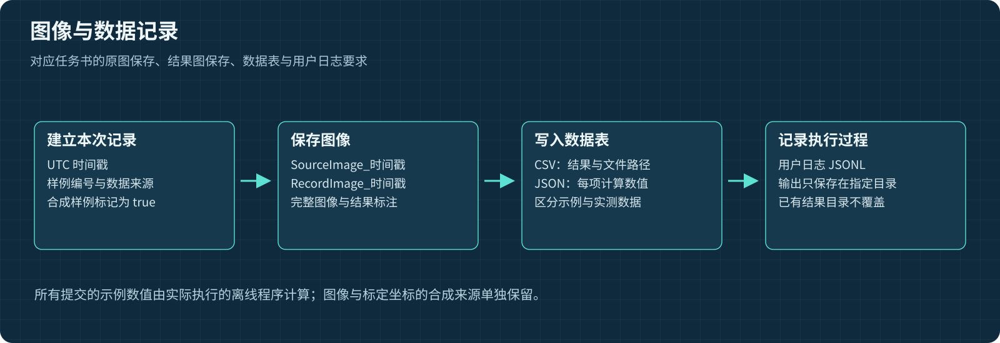

### 九点平面映射

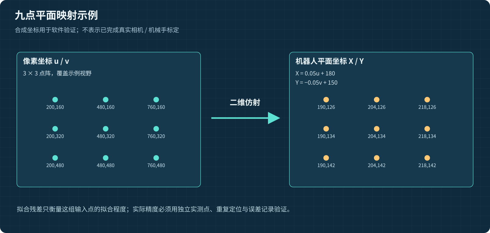

### 光学计算练习

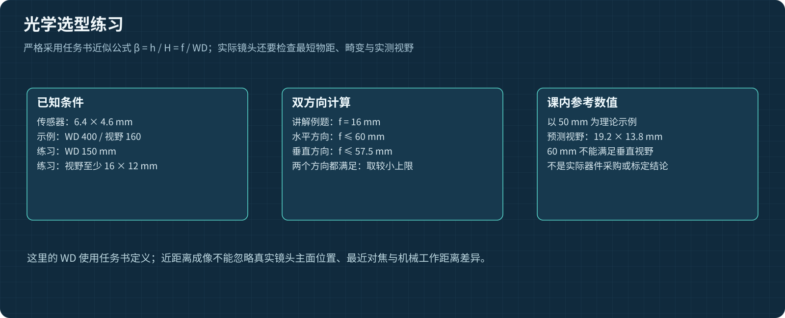

## 离线计算结果

根据随附程序生成的六个样例结果绘制，输入为合成图。逐图原始结果可从 `examples/demo/index.html` 本地打开查看。

## 原基线流程

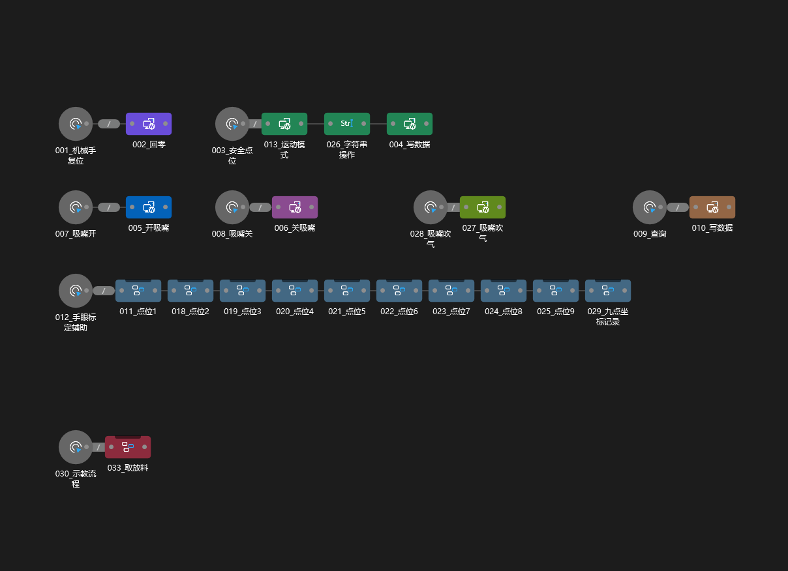

原工程自带的流程缩略图，保留其原分辨率。原 HMI 本身为空，因此没有把新页面说成原 V+ 的运行截图。

## 原培训任务书插图

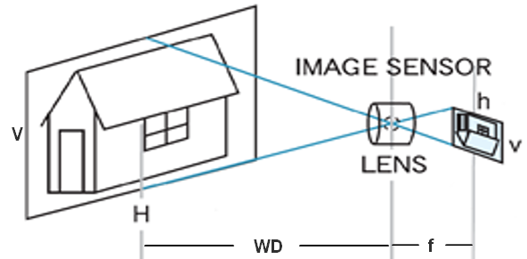

成像几何说明；来源为获准公开的培训任务书，不是本次程序运行截图。

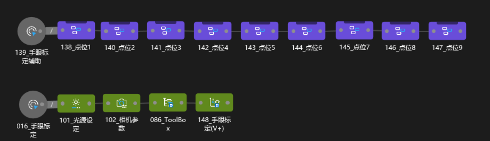

九点标定/示教流程示例；来源为获准公开的培训任务书，不是本次程序运行截图。

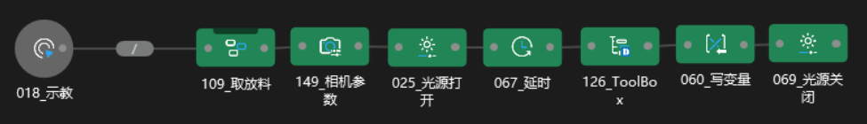

相机与光源流程示例；来源为获准公开的培训任务书，不是本次程序运行截图。

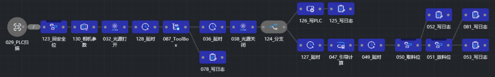

PLC 与视觉流程示例；来源为获准公开的培训任务书，不是本次程序运行截图。

## 从基线提取的完整训练参考图

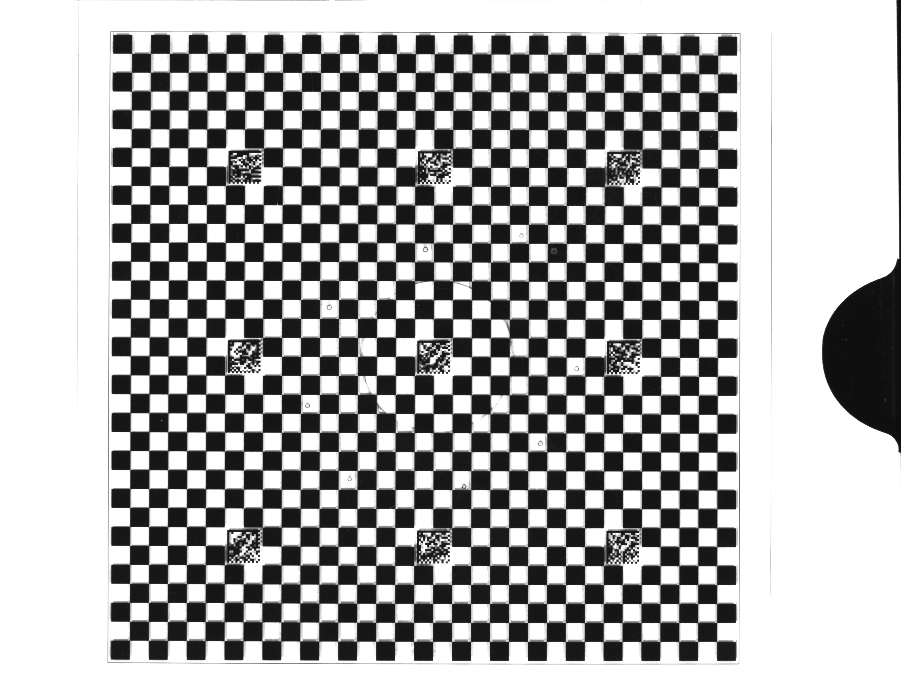

原基线中的标定板参考图，保留 2592 × 1944 全幅像素。来源和解码记录见清单。

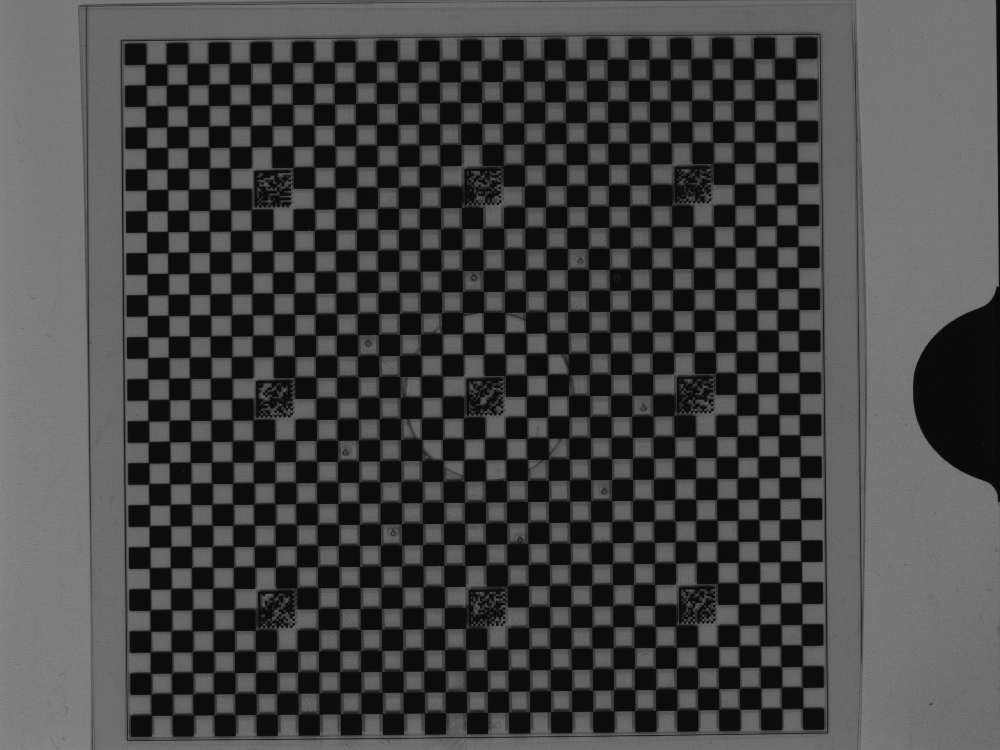

原基线中的标定板参考图，保留 2592 × 1944 全幅像素。来源和解码记录见清单。

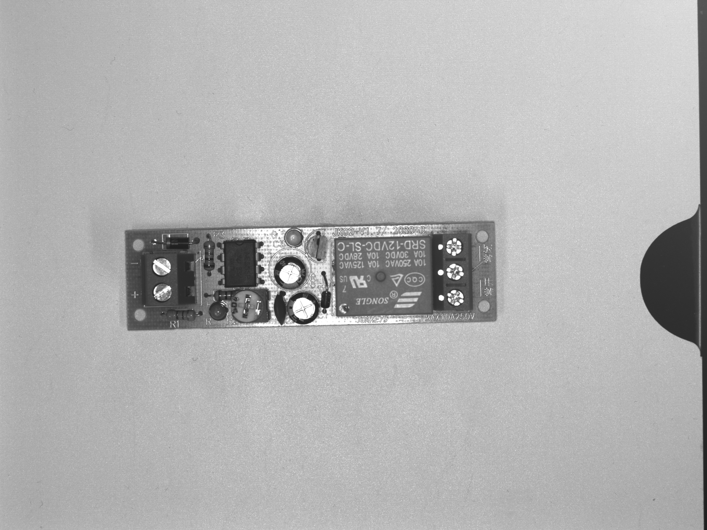

原基线中的PCB 参考图，保留 2592 × 1944 全幅像素。来源和解码记录见清单。

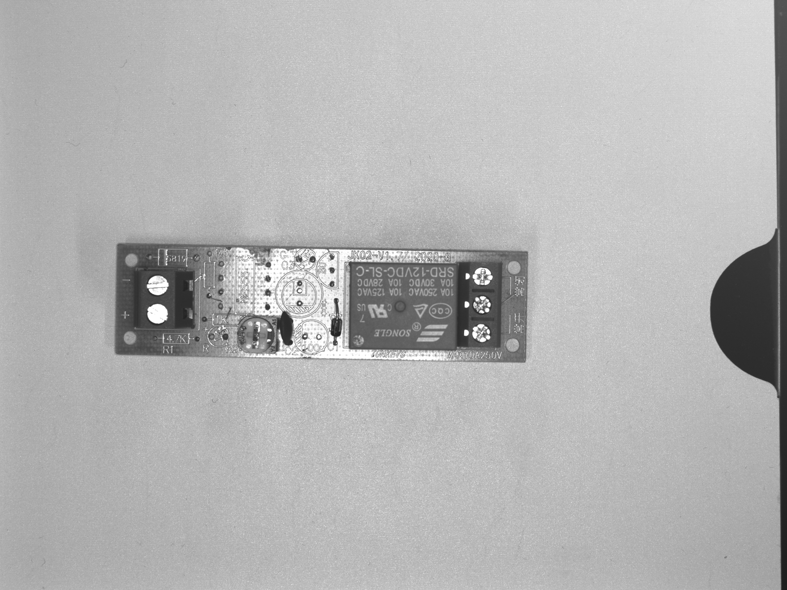

原基线中的PCB 参考图，保留 2592 × 1944 全幅像素。来源和解码记录见清单。

## 真实器件外部参考照片

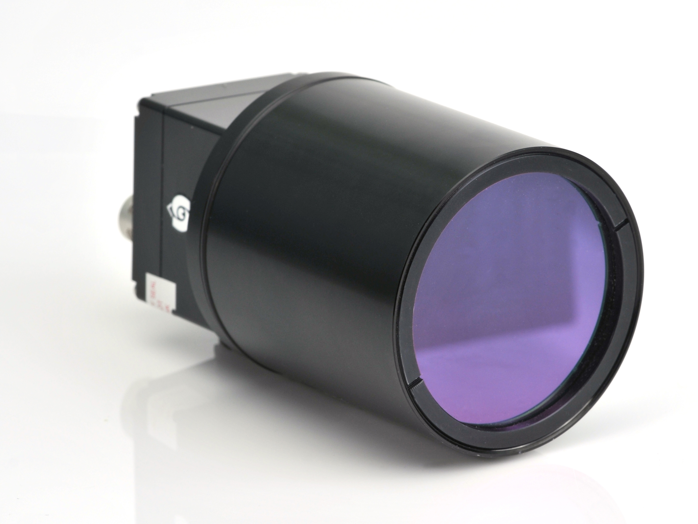

Alexander Lucke / Wikimedia Commons，CC BY-SA 3.0，原字节未修改。仅作相机外形参考，非作者实物、非已选型器件。[原图与许可](https://commons.wikimedia.org/wiki/File:SVCam-ECO_Series_black_with_Tubus.JPG)。

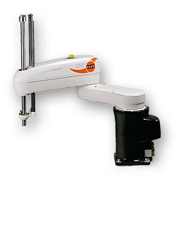

Jo Teichmann / KUKA Roboter GmbH，原页公有领域声明。仅作机构类别参考，非当前桌面机械手型号或作者实物。[原图与许可](https://commons.wikimedia.org/wiki/File:KUKA_Industrial_Robot_KR10_SCARA.jpg)。

完整署名与许可范围见 [第三方说明](../THIRD_PARTY_NOTICES.md)。
